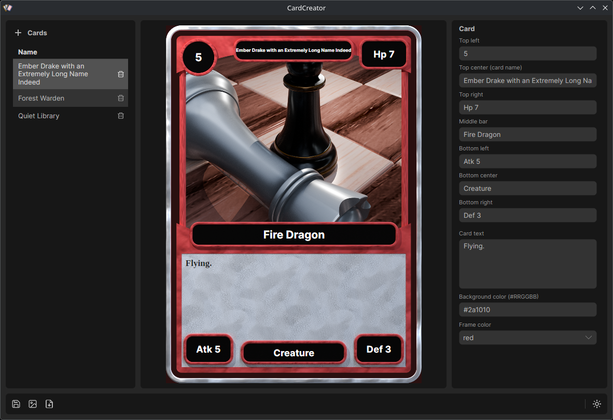

# CardCreator

Design your own trading cards, then print them.

Pick a frame color, drop in your artwork, type the name, the stats and the rules text, and watch the card come together as you type. When it looks right, export a print-ready picture and take it to your printer or print it at home.



---

## Make a card

1. **Start a new card.** Press the **+** next to *Cards* (or **Ctrl+N**).
2. **Choose the art.** Press the picture button at the bottom left and pick an image from your computer. The art window is almost square (a little wider than tall), and your picture is trimmed to fill it, so pictures of about that shape work best.
3. **Fill in the card.** Type into the boxes on the right. The card updates as you go.
4. **Pick a frame color and a background color.**
5. **Save it** with the disk button (or **Ctrl+S**). Your card appears in the list on the left.

Cards you have made stay in that list. Click one to open it again, or press the little trash can on its row to delete it.

## What goes where

| Box | Where it sits on the card | Often used for |
|-----|---------------------------|----------------|
| Top left | The round badge, top left | Cost |
| Top center | The banner across the top | The card's name (every card needs one) |
| Top right | The badge, top right | Health or power |
| Middle bar | The bar under the art | Type, family or a short tagline |
| Bottom left | Bottom left badge | Attack |
| Bottom center | Bottom middle badge | Card type or rarity |
| Bottom right | Bottom right badge | Defense |
| Card text | The big box at the bottom | Rules, abilities, flavor text |

These are only suggestions. Put whatever your game needs in them.

- **Leave a box empty** and its badge disappears from the card, so a simple card can have fewer badges.
- **Long text shrinks to fit** its badge or box, so a long name never spills over the edge.

## Frame colors

Sixteen colors to choose from: red, blue, green, purple, black, white, crimson, teal, orange, pink, navy, forest, ice, obsidian, bone and toxic. They are good for telling the suits, factions or rarities of your game apart at a glance. The frame was rendered in Blender, so it has a real shine and texture.

Cards you made with the old metallic colors (silver, gold, bronze and copper) open in the nearest new color (white and orange). A metallic frame is planned as its own set.

## Printing

### Print sheets (the printer button, or **Ctrl+P**)

This lays your cards out on paper, ready to print and cut. It makes a PDF at true size, so each card comes out exactly 2.5 × 3.5 inches.

1. **Choose the cards.** Tick the ones you want and set how many copies of each (a deck often needs three of one card and one of another). *All* and *None* are there for speed.
2. **Pick the paper.** Letter, Legal, A4, A3, Tabloid (11 × 17) or 12 × 18, portrait or landscape. Work in inches or millimetres, whichever you prefer.
3. **Set the margin and the gap.**
   - *Printer margin* is the edge of the paper your printer can't print on. Most home printers need about a quarter inch (6 mm).
   - *Gap between cards* is the space between neighbours. With **0** they share a single cut line, which means fewer cuts and less waste.
4. **Crop marks** are small tick marks in the margin, lined up with every card edge, so you can cut straight without any lines landing on the cards. If there isn't room for them on some side, it tells you.
5. Watch the **preview** on the right (use the arrows to flip through the sheets). It tells you how many cards fit on a sheet and how many sheets you'll need.
6. Press **Make PDF**.

When you print the PDF, choose **Actual size** (or 100%). *Fit to page* shrinks the cards.

The starting settings are **landscape, a quarter-inch margin and a tenth-of-an-inch gap**. Here is how many cards fit on a sheet with those:

| Paper | Landscape | Portrait |
|-------|-----------|----------|
| Letter | 8 (4 × 2) | 6 (3 × 2) |
| Legal | 10 (5 × 2) | 9 (3 × 3) |
| A4 | 8 (4 × 2) | 9 (3 × 3) |
| A3 | 18 (6 × 3) | 16 (4 × 4) |
| Tabloid 11 × 17 | 12 (6 × 2) | 16 (4 × 4) |
| 12 × 18 | 18 (6 × 3) | 16 (4 × 4) |

Set the gap to **0** (neighbouring cards share one cut line) and a few sizes fit more: Letter portrait 9, Tabloid landscape 18, 12 × 18 portrait 20 and landscape 21. The window shows the exact count as you change things.

Your settings are remembered, so next time it's one click.

### One picture per card

- The export button (or **Ctrl+E**) saves the open card as a PNG picture: 1500 × 2100 pixels, which is 2.5 × 3.5 inches at 600 dots per inch, the standard trading card size. Print shops and print-at-home programs read the size straight from the file.
- The folder button (or **Ctrl+Shift+E**) exports *every* card in one go. Pick a folder and you get one picture per card, named after the card (`Ember_Sprite.png`, `Toxic_Slime.png`, ...). Save the card you are working on first, so its latest changes are included. If the folder already has files with the same names, you are asked before they are replaced.

## Good to know

- **Unsaved changes.** A star appears in the title and the status line says *Unsaved changes*. If you try to open another card or close the program, it asks first, so nothing is lost by accident.
- **Light or dark.** The sun/moon button at the bottom right switches the look of the program. It remembers your choice.
- **Your cards are kept on your own computer.** Nothing is sent anywhere. They live in a small folder next to your other program settings:
  - Windows: `%APPDATA%\CardCreator`
  - Linux: `~/.config/CardCreator`

  Copy that folder to back up your cards and your art, or to move them to another computer.

## Get the program

Ready-to-run versions for Windows and Linux are on the download page: [TCG-Creator @ KillGorack.com](https://www.killgorack.com/PX4/index.php?ap=software&id=9&cn=det)

---

## Building it yourself

For the curious: CardCreator is written in C# with [Avalonia](https://avaloniaui.net/) and needs the .NET 9 SDK.

```bash
git clone https://github.com/KillGorack/TCG-Creator.git
cd TCG-Creator/CardCreator
dotnet run
```

To make a stand-alone copy to hand out:

```bash
dotnet publish -r linux-x64 --self-contained -c Release    # Linux
dotnet publish -r win-x64 --self-contained -c Release      # Windows
```

The card frame is a "frame set": a folder of four rendered pictures plus a small file listing the colors (`CardCreator/Assets/frames/monolith`). Any color is worked out from those pictures on the spot, so adding a color is one line in `set.json`, not a new render. `tools/render_set.py` makes the four pictures from the Blender file.

The look of the program follows Dave's own design standard (dark and light themes, quiet colors). The bundled card font, Liberation Serif, is licensed under the SIL Open Font License; the license sits next to the font file.
